# Musafira

**we care for your safety.**

*Musafira* is Hindi/Urdu word for a traveller.

For each trip it compares up to three routes and scores every 100 m of each one for the minute you will actually be there. Is the street lit after dark? Is a police station or a 24-hour pharmacy open? Are people around? Will your phone have signal? Then it helps with the rest of the journey: a preview that rides the route before you do, an auto that is booked to follow the safe route, washrooms you can trust, and day trips that bring you home before dusk.


Live at **[musafira.app](https://musafira.app)**. Covers Pune and Bengaluru under first phase.

## Contents

1. [What it does](#what-it-does)
2. [The core idea](#the-core-idea)
3. [Architecture (HLD)](#architecture-hld)
   - [System context](#system-context)
   - [Tech stack](#tech-stack)
   - [Which part powers which feature](#which-part-powers-which-feature)
   - [Layers and the rules between them](#layers-and-the-rules-between-them)
4. [How requests flow (LLD)](#how-requests-flow-lld)
   - [Plan and rescore a route](#plan-and-rescore-a-route)
   - [A route search, file by file](#a-route-search-file-by-file)
   - [Inside the scoring engine](#inside-the-scoring-engine)
   - [Book this route](#book-this-route)
   - [Safe Stops and domain proof](#safe-stops-and-domain-proof)
   - [Rider reports](#rider-reports)
   - [Day trips](#day-trips)
   - [Place search, washrooms and contact](#place-search-washrooms-and-contact)
5. [Data](#data)
   - [Offline city ingest](#offline-city-ingest)
   - [Data models](#data-models)
   - [Where state lives, and the caches](#where-state-lives-and-the-caches)
6. [The web app](#the-web-app)
7. [API reference](#api-reference)
8. [Design decisions](#design-decisions)
9. [Security and privacy](#security-and-privacy)
10. [Hosting and deployment](#hosting-and-deployment)
11. [Run it locally](#run-it-locally)
12. [Testing and CI](#testing-and-ci)
13. [Project layout](#project-layout)
14. [Limits and what's next](#limits-and-whats-next)
15. [Data sources and credits](#data-sources-and-credits)

## What it does

| Feature | What the rider gets |
| --- | --- |
| **Safer routes** | Up to three two-wheeler routes, each scored 0–100 for the departure time and labelled *safest* and *fastest*. Every segment is coloured by safety on a 3D map. |
| **Safety DNA** | Eight sliders (0–10) and four presets: Balanced, Riding alone at night, Stay connected and Low on fuel. Scores update while you drag. Kept in the browser and synced to your account if you sign in. |
| **Ride preview** | The camera rides the route and warns about dark stretches and signal dead zones before you reach them. Three camera presets, a speed control and pause. |
| **Place search** | Type-ahead over 17,650 names in Pune and 51,907 in Bengaluru, housing societies included. Tolerates typos and transliteration, so "Pruthvi" finds "Prithvi". |
| **Rider reports** | Signed-in riders mark what they saw: poorly lit, deserted, harassment, bad road, waterlogged, no signal, police nearby and more. Reports correct the scores for riders passing at a similar hour, fade over weeks, and never record who sent them. |
| **Book this route** | Hands the safe route to an auto, with safety checkpoints as stops so the driver's route and fare follow it. Shows fare and score next to the usual route, tracks the driver, and raises an alert with Share trip and Call 112 if the ride strays more than 100 m. Live on Namma Yatri in Bengaluru, a demo everywhere else. |
| **Washrooms near me** | Open washrooms within 4 km, ranked by ride time: Musafira Safe Stops first, then OpenStreetMap public toilets and fuel stations. Filters for women's, free, pads, attendant and accessible. |
| **Safe Stops** | Shop owners list their place for riders (washrooms, hours, period care, safety features and the Safe Stop Promise) and prove it by owning a GoDaddy domain. Listed stops count as safety stops in route scores and get a public page at `/s/<id>`. |
| **Day trips** | Half a day to three days from a base place. Claude Haiku picks real places from a list the server provides; the server sets times in city time, checks opening hours and keeps rides before dusk. Works without AI too. |
| **Contact** | A contact form that delivers to the site's GoDaddy mailbox. |

The map opens on a night basemap with a day/night toggle. Phones get their own layout with a draggable bottom sheet.

## The core idea

Most route apps ask "how long will it take?" Musafira asks "what will this street be like when I get there?" A road that is busy at 7 pm can be empty and dark at 11 pm, and the pharmacy that could help at 8 pm is shuttered at midnight. So the unit of scoring is not the route but **a 100 m segment at the minute you arrive on it**.

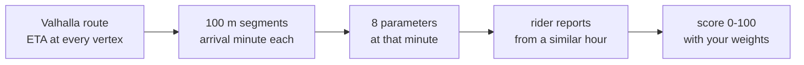

| Parameter | Default weight | Measured from |
| --- | :-: | --- |
| Street lighting | 10 | NASA night-light radiance (65%) blended with road class. Counts only once the sun is below civil twilight. |
| Safety stops | 9 | Police, hospitals, fuel pumps and 24/7 places open when you pass. Long gaps are penalised. |
| People around | 8 | Live TomTom traffic when leaving now, otherwise open shops, bus stops and stations at your arrival time. |
| Mobile signal | 5 | OpenCelliD cell density. Dead zones are penalised. |
| Essential services | 5 | Hospitals, clinics, pharmacies and police within 300 m. |
| Shops open | 5 | Shops and eateries still open 15 minutes after you pass. |
| Breakdown help | 4 | Fuel pumps and tyre or bike repair shops open along the way. |
| Road type | 3 | Main roads over lanes, service roads and underpasses. |

The score, from [`src/safety/scoring.ts`](src/safety/scoring.ts):

```text
segment score = weighted mean of the parameters measured on that segment
base          = 0.6 × length-weighted mean + 0.4 × mean of the worst 10% of route length
score         = 100 × base × (1 − penalties / 100)
```

Penalties are percentages: dark stretches longer than your threshold (500 m by default) up to 25, signal dead zones of 300 m or more up to 15, a gap between safety stops longer than your limit (2 km by default) up to 15, and stretches riders reported as unsafe up to 15. Missing data neither helps nor hurts a segment; it lowers the route's confidence instead.

## Architecture (HLD)

### System context

One Node.js process on GoDaddy Node.js Hosting serves both the web app and the API from a single origin. Everything that changes slowly (map places, night lights, cell towers) is prepared offline into one JSON file per city. A route search therefore calls out only for the routes themselves and, when you leave now, for live traffic.

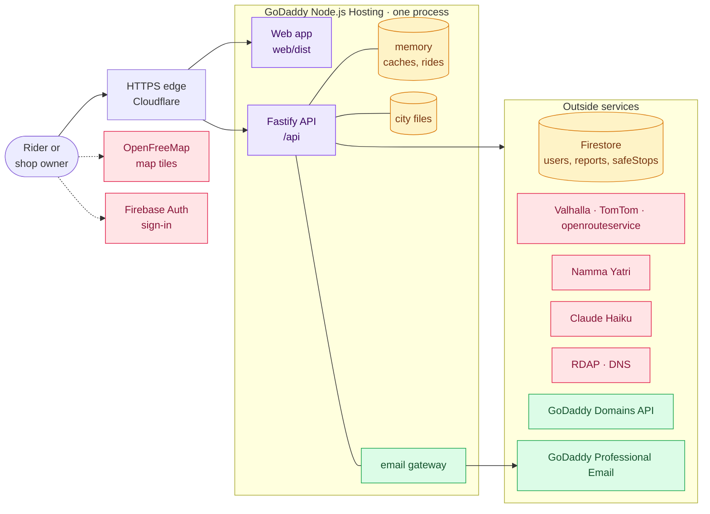

Purple is our code, amber is stored data, green is GoDaddy and rose is other outside services. The API verifies each signed-in request's Firebase ID token itself; the browser talks to Firebase only to sign in.

### Tech stack

| Part | Tech |
| --- | --- |
| API | Node.js 20+, TypeScript 7 (strict), Fastify 5, zod 4 at every boundary |
| HTTP hardening | `@fastify/helmet` (CSP), `@fastify/rate-limit`, `@fastify/cors` |
| Geo and time | `kdbush` spatial index, `suncalc` for dusk, `opening_hours` for OSM hours |
| Identity and storage | Firebase Auth, Firestore through `firebase-admin` (server only) |
| Web | React 19, Vite 8, MapLibre GL 6, deck.gl 9, Firebase Auth web SDK |
| Integrations | Valhalla, TomTom, openrouteservice, Namma Yatri, Anthropic, GoDaddy Domains, RDAP, DNS, `nodemailer` |
| Tests and CI | Vitest 3, Fastify `inject`, GitHub Actions |
| Hosting | GoDaddy Node.js Hosting, deployed with the `gddy` CLI |

### Which part powers which feature

Each row is one feature, traced from the web app to the data it needs. Colours mark the layer, so you can see at a glance that, for example, *Book this route* leans on the pure ride engine and two outside services, while *Ride preview* never calls the server.

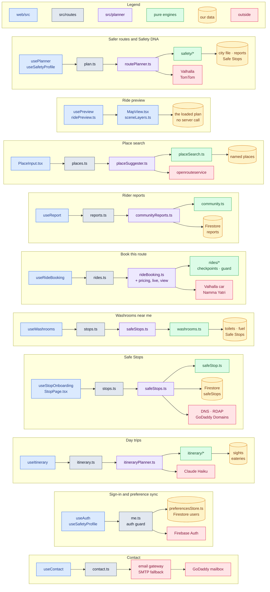

### Layers and the rules between them

The API is a ports-and-adapters design. The engines that decide anything about safety, rides, trips or washrooms are pure functions: no network, no database, no clock (time is passed in). Services around them do the IO and caching, and talk to the outside world only through small interfaces called *ports*. `server.ts` is the one place that picks real implementations, which is why every test runs on fakes without touching the network.

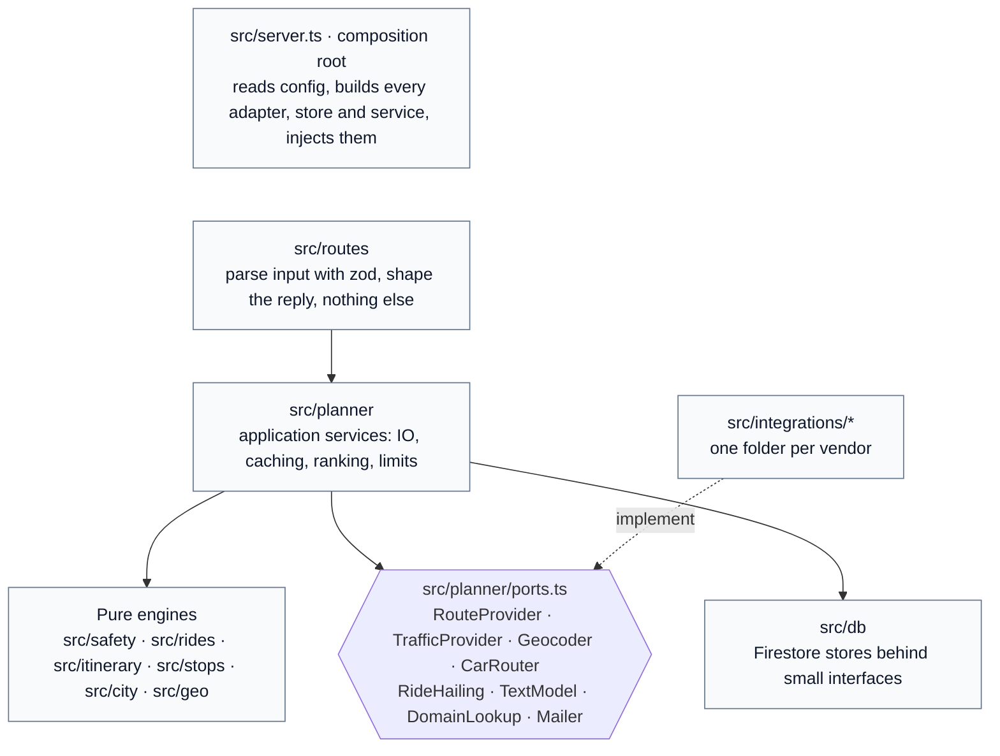

| Rule | Why |
| --- | --- |
| Routes only parse and shape | HTTP concerns stay out of the logic, and every input is validated with zod before it reaches a service. |
| Engines are pure | Same input, same output. Tests build synthetic cities and compare routes, without mocks or network. |
| Services depend on ports, not vendors | Valhalla, TomTom or Namma Yatri can be swapped, and each feature degrades on its own when a key is missing. |
| `src/config/env.ts` is the only reader of `process.env` | Config is validated once at start-up and fails fast. |
| Client-visible failures are `AppError`s | Callers get a stable code and message; upstream details never leak. |

## How requests flow (LLD)

### Plan and rescore a route

Planning has two stages. The expensive one fetches and *measures* routes once; the cheap one *weighs* those measurements again whenever the rider moves a slider. That split is what makes the Safety DNA sliders feel live.

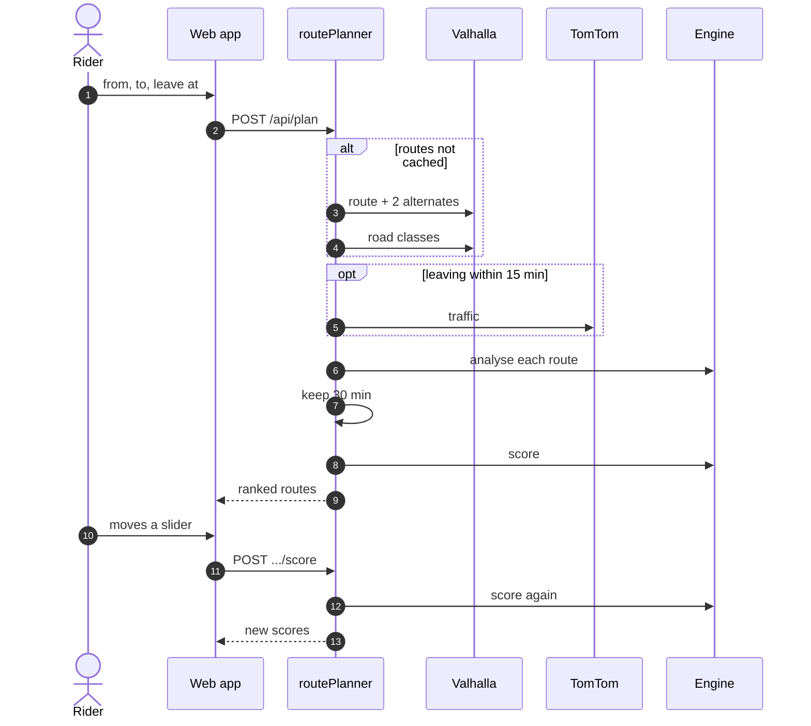

The web app sends a rescore 140 ms after the slider stops, to `POST /api/plan/<searchId>/score`. Traffic is snapshotted at plan time, so rescoring is deterministic. Stored searches hold route geometry, so they stay in process memory and are never logged.

### A route search, file by file

The same request, following the code. Each box is a file and the one job it does on this path.

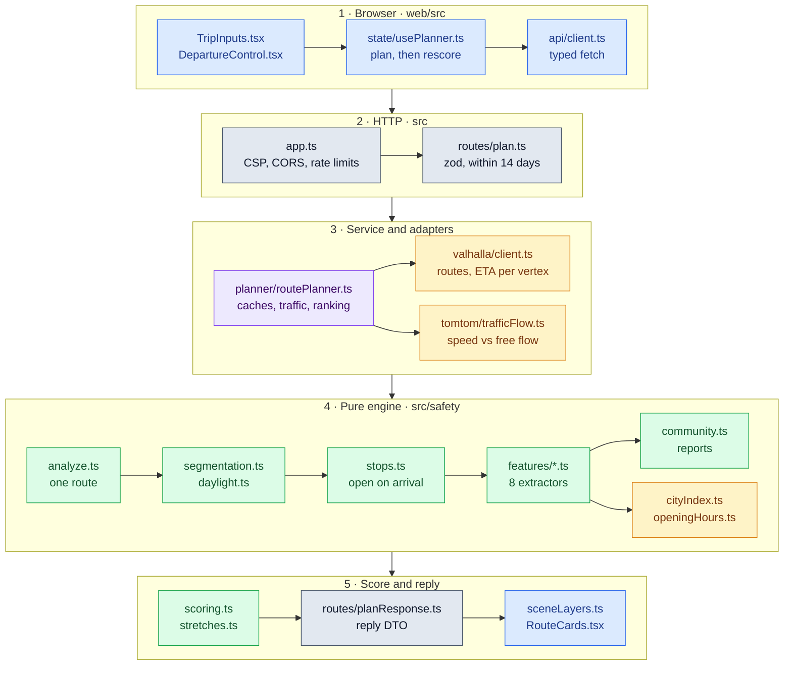

### Inside the scoring engine

`analyze.ts` turns a candidate route into a `RouteAnalysis`: a value from 0 to 1 for every parameter on every segment, plus stops and reported stretches. That happens once per search. `scoring.ts` turns an analysis into a score for one set of weights, and runs on every slider move.

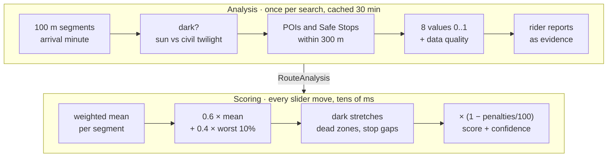

Two choices keep the score honest. The worst-10% term and the penalties stop a long, well-lit main road from hiding one isolated dark stretch, which averaging alone would do. Applying penalties as a share of the base, rather than subtracting them, keeps two bad routes distinguishable instead of both flooring at 0. Every penalty scales with the weight of its parameter, except the reported-stretch penalty: harassment reports are not something a rider opts out of.

### Book this route

Ride apps route and price a ride through the stops they are given. Musafira uses that: it adds *safety checkpoints*, at most 3, until a car route covers 90% of the safe route, and sends them as stops.

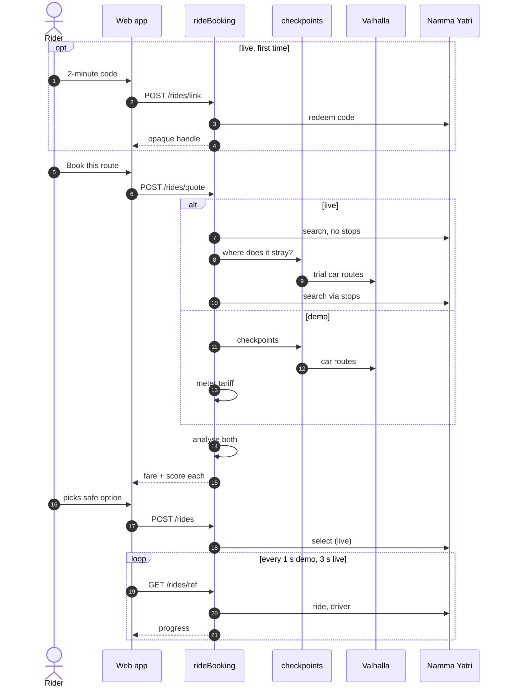

Paths are under `/api`. `rideBooking.ts` is the facade: `ridePricing.ts` prices the trip, `liveRides.ts` follows a live booking, `rideView.ts` shapes what the rider sees and `rideSessions.ts` holds Namma Yatri sign-ins. Live means Bengaluru, a ride leaving now and a linked account; selecting the estimate is the only step that asks a driver. Demo works in any city with a meter tariff and contacts no one. Both options are analysed at the plan's departure time with the rider's weights and reports, so "+₹X for N points safer" compares like with like.

- **Checkpoint search** ([`src/rides/checkpoints.ts`](src/rides/checkpoints.ts)): route by car through the checkpoints so far; while coverage is under 90%, add one at the middle of the longest stretch the car route misses. Misses under 150 m and the first and last 300 m are ignored, and the search stops if a checkpoint bends the route past 1.25× the safe route's length.
- **Route guard** ([`src/rides/guard.ts`](src/rides/guard.ts)): a ride is off route once its last 3 driver positions are all more than 100 m from the booked route, the same rule Namma Yatri applies to its own drivers. Needing three in a row absorbs single GPS jumps between tall buildings; one position back on the route clears it.
- **Demo rides** ([`src/rides/demoRide.ts`](src/rides/demoRide.ts)) use the government auto meter tariff (Bengaluru ₹36 for 2 km then ₹18/km, 1.5× from 22:00; Pune ₹30 for 1.5 km then ₹20/km, +25% after midnight) and a simulated driver whose whole ride fits in about two minutes. "Simulate a wrong turn" pushes the driver off route to show the guard working.
- **Live rides** are off unless `NAMMA_YATRI_LIVE=true`. The Namma Yatri token lives only in server memory for 12 hours; the browser keeps an opaque handle in `sessionStorage`.

### Safe Stops and domain proof

A shop becomes a Safe Stop when its owner proves control of a GoDaddy domain. Only someone who controls the domain's DNS can publish the record, and RDAP confirms GoDaddy is the registrar.

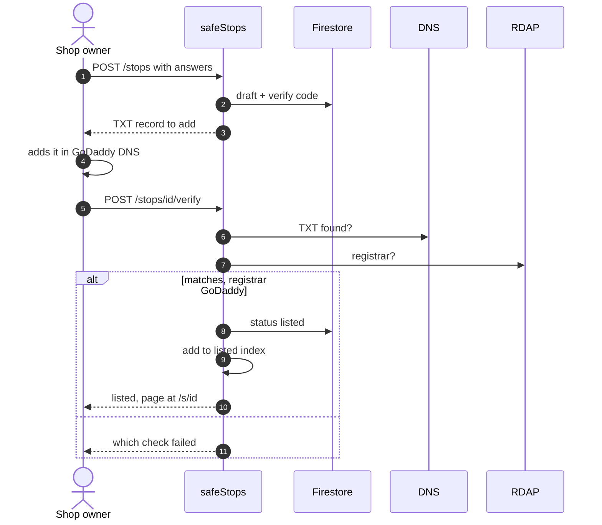

- The record is `_musafira.<domain>` with the value `musafira-verify=<code>`. It has its own name so it never clashes with mail SPF or other site verifications.
- `dns/txt.ts` asks the zone's nameservers first because shared resolvers cache "no such record" for minutes, which would hide a record the owner just added.
- Changing a stop's domain takes it back to draft with a new code. One account can list up to 5 stops and run 20 verifications an hour.
- **Domain ideas** for owners without a domain: a name the registries (RDAP) know is registered counts as taken, whatever GoDaddy's sandbox says; otherwise GoDaddy's availability API decides. Answers are cached for an hour. Musafira links to GoDaddy to buy and never buys a domain itself.
- Listed stops are loaded into memory at start-up and updated on every change, so planning never waits on the database.

### Rider reports

Reports are evidence that corrects the sensor-based measurements, weighted by how fresh, how close and how well-timed they are.

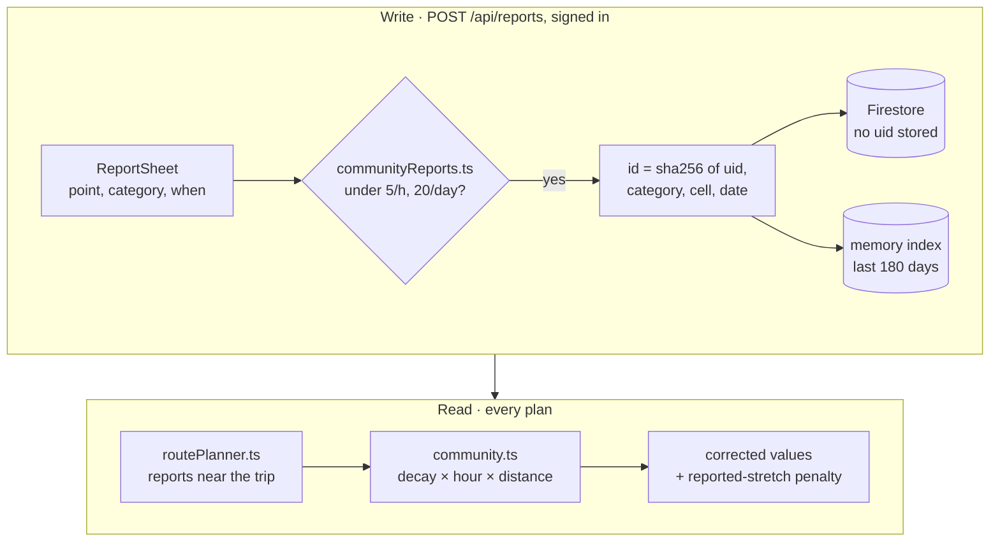

```text
weight of a report  w  = 2^(−age / half-life) × time match × falloff
corrected value     v' = (2v + E⁺) / (2 + E⁺ + E⁻)
```

The sensor counts like two fresh reports: one report nudges it, three overturn it. Half-lives follow how long a fact stays true: 7 days for waterlogging, 21 for a deserted road, 30 for lighting, 90 for harassment. Lighting reports apply only on dark segments; people-around and personal-safety reports match the time of day (morning, afternoon, evening, night, in city time). Hashing the id means a rider repeating the same report at the same spot on the same day overwrites it instead of stacking evidence.

### Day trips

The AI chooses, the server decides. Claude Haiku sees a numbered list of real places and replies with one short line per stop. It never returns times, routes or ratings, and it cannot add a place that is not on the list.

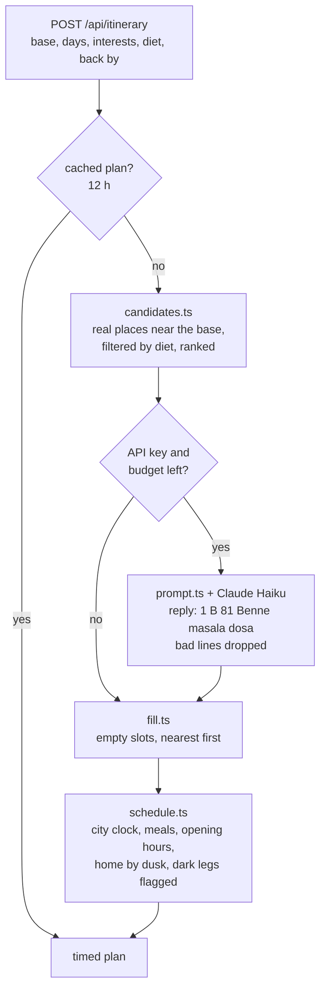

Each reply line is day, slot and place: `1 B 81 Benne masala dosa` means day 1, breakfast, place 81, with a short note. Each line is checked on its own, and anything else (an unknown ref, the wrong slot, a repeat) is dropped. Lines beat JSON on output tokens, and a reply cut off mid-way still yields every complete line. A plan costs about $0.0006; spend is summed per UTC day and the model is skipped once it reaches `ANTHROPIC_DAILY_BUDGET_USD`. The model sees place names, areas and tags, and nothing about the rider. Any leg of the plan opens in the route planner for a full safety check.

### Place search, washrooms and contact

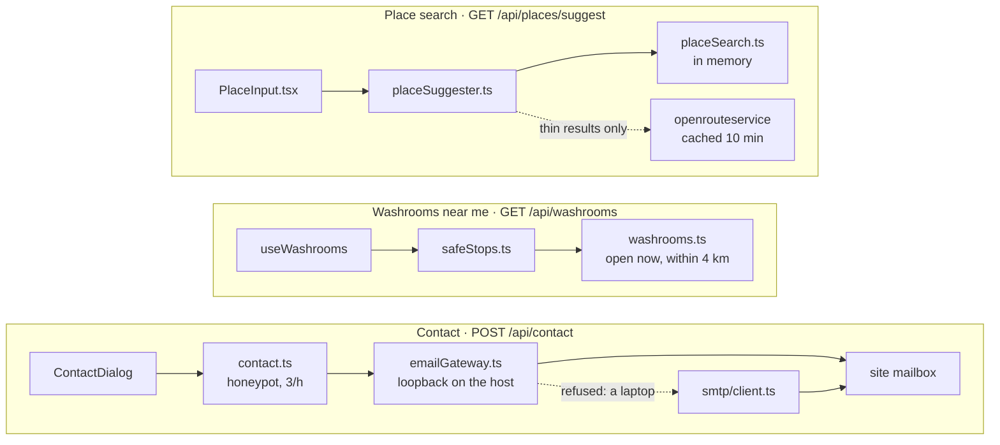

- **Place search** ([`src/city/placeSearch.ts`](src/city/placeSearch.ts)) matches every typed word against a different word of a name: exactly, as a prefix, by a sound key built for Indian transliteration (vowel runs fold, w = v, z = j, the h of bh/ch/dh/kh/ph/sh/th drops), or within a typo per four letters. It answers in a few milliseconds and knows housing societies, which Pelias does not import.
- **Washrooms** ([`src/stops/washrooms.ts`](src/stops/washrooms.ts)) rank by an effective ride time: ride minutes, plus 4 when women's access is not recorded and 2 when hours are only typical, minus 3 for a listed Safe Stop and 1 each for a woman attendant, a lock inside and pads on hand. Every fact is returned, so filters need no extra request.
- **Contact mail**: GoDaddy hosting lets apps connect out only over HTTP and HTTPS, so SMTP can't leave the container; the hosting email gateway on loopback is the way out there. Off hosting, mail goes over SMTP from and to the site's own mailbox, so SPF and DKIM line up; the visitor goes in Reply-To.

## Data

### Offline city ingest

Each city is a single JSON file built offline and committed to git. The API loads and validates it at start-up, so no route search waits on a POI or night-light API.

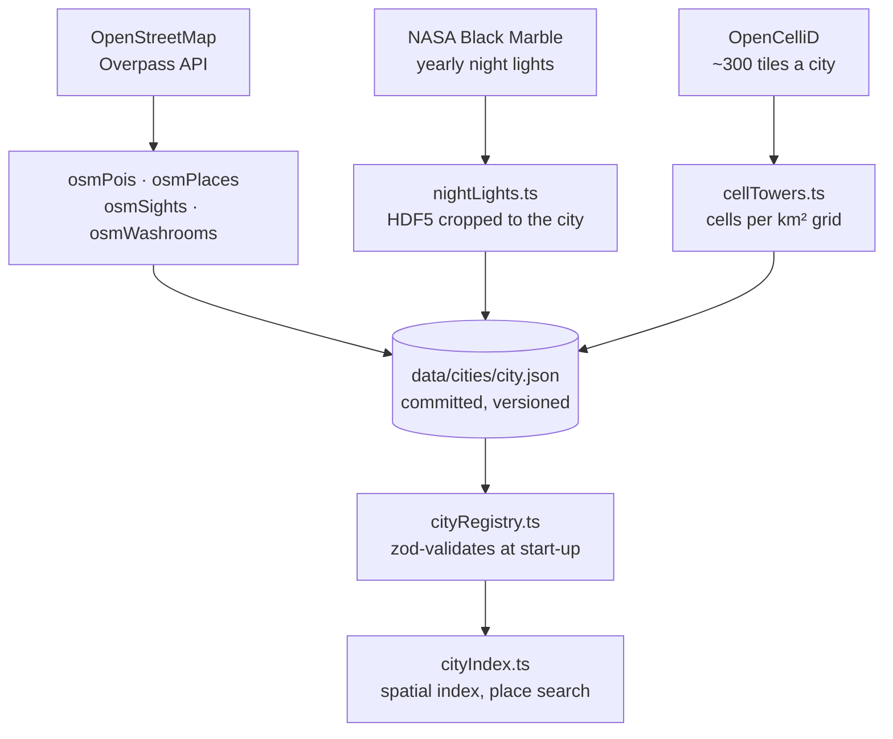

The scripts live in `scripts/ingest/`. Raw downloads are cached in `data/raw/` (gitignored), so a re-run only rebuilds the output.

City data at a glance (version 2026-11-16):

| City | POIs (with hours) | Searchable names | Sights | Public toilets | Night-light grid | Cell grid |
| --- | --: | --: | --: | --: | :-: | :-: |
| Pune | 8,223 (979) | 17,650 | 789 | 94 | 84 × 72 | 20 × 17 |
| Bengaluru | 26,187 (2,001) | 51,907 | 1,659 | 495 | 84 × 79 | 20 × 19 |

Most Indian POIs carry no opening hours, so [`src/city/openingHours.ts`](src/city/openingHours.ts) falls back to category defaults and flags them as estimated, which lowers confidence rather than pretending to know.

### Data models

**City file** (`data/cities/<id>.json`, schema in [`src/city/cityData.ts`](src/city/cityData.ts)). `?` marks an optional field; a missing one means "the source doesn't say", never "no".

```text
city
├─ id, name, version, center, bbox, utcOffsetMinutes      (330 for India)
├─ pois[]         id, lon, lat, cat, name?, hours?         cat: 17 kinds, police to safe_stop
├─ places[]       id, name, lon, lat, kind, aka[]?         kind: area | residence | landmark | street
├─ sights[]       id, name, lon, lat, kind, famous?, hours?
├─ washrooms[]    id, lon, lat, name?, hours?, women?, free?, wheelchair?, babyChanging?, pads?
├─ lights?        grid of night-light radiance             west, north, cellDegrees, cols, rows, values[]
├─ cellDensity?   grid of cell IDs per km²                 same shape, null where there is no data
└─ sources[]      name, license, attribution, url
```

**Firestore** (only the server touches it, through `firebase-admin`). Reports deliberately have no link to a user.

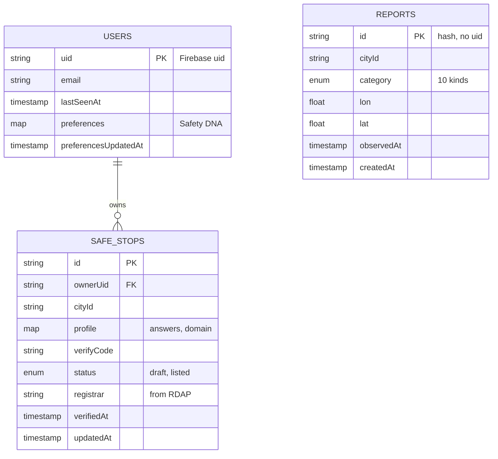

A Safe Stop's `profile` mirrors OSM toilet tags where one exists (women and unisex counts, access and fee, pads, accessible, baby changing), so vendor and OSM washrooms rank on the same facts.

**Runtime models** (in memory, [`src/safety/types.ts`](src/safety/types.ts) and [`src/planner/rideTypes.ts`](src/planner/rideTypes.ts)):

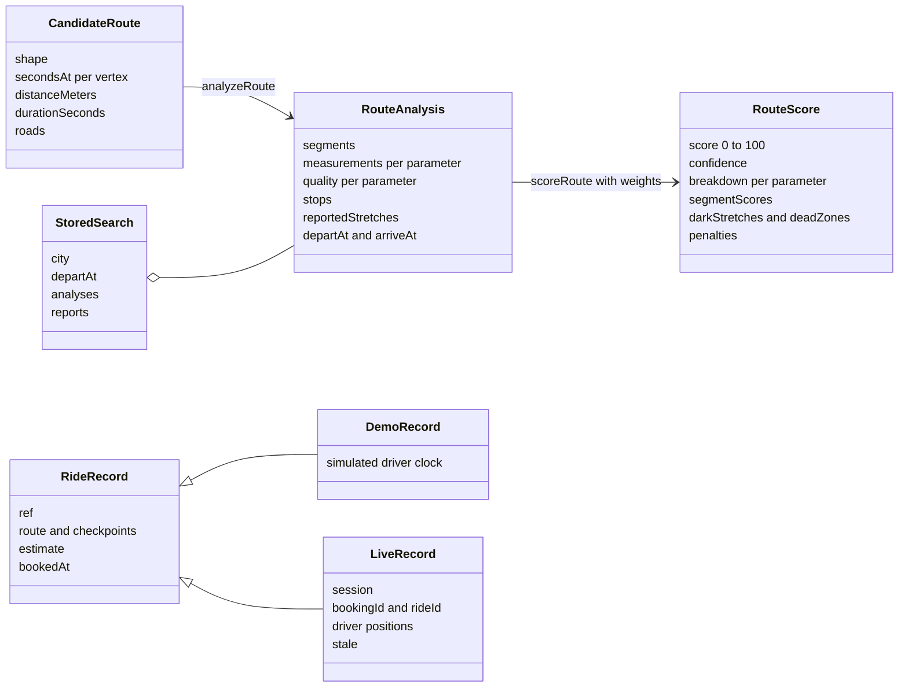

### Where state lives, and the caches

There is no Redis and no extra database. State lives in four places, and everything in process memory is bounded by size and time.

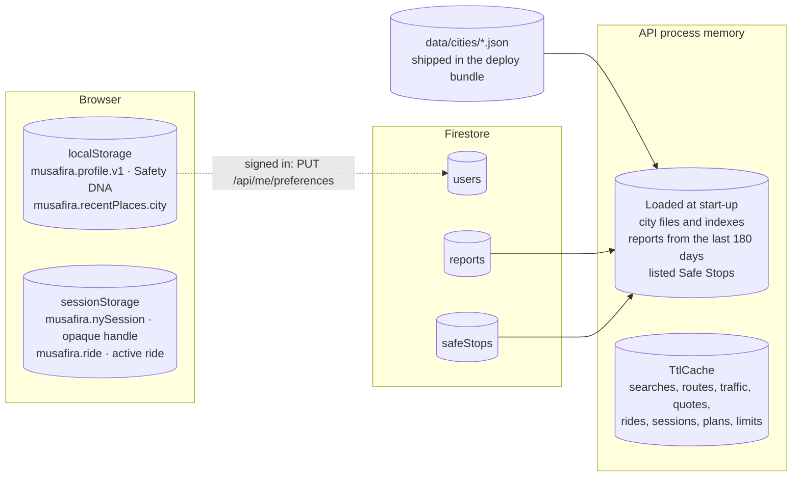

Every cache is a `TtlCache` ([`src/lib/ttlCache.ts`](src/lib/ttlCache.ts)): entries expire, and the oldest is evicted when it is full.

| What | Owner | Lifetime | Max entries |
| --- | --- | --: | --: |
| Route candidates per trip | `routePlanner.ts` | 10 min | 200 |
| Traffic readings | `routePlanner.ts` | 2 min | 2,000 |
| Stored searches (analyses, for rescoring) | `routePlanner.ts` | 30 min | 500 |
| Remote place suggestions | `placeSuggester.ts` | 10 min | 1,000 |
| Day-trip plans | `itineraryPlanner.ts` | 12 h | 300 |
| Ride quotes | `rideBooking.ts` | 10 min | 500 |
| Rides | `rideBooking.ts` | 4 h | 500 |
| Namma Yatri sessions | `rideSessions.ts` | 12 h | 1,000 |
| Domain availability | `safeStops.ts` | 1 h | 2,000 |
| Verification attempts per owner | `safeStops.ts` | 1 h | 10,000 |
| Report times per rider | `communityReports.ts` | 1 day | 10,000 |

The browser caches too: hashed assets for a year, the city's raster layers for a day, and `index.html` is revalidated on every load so a deploy shows up straight away.

## The web app

`main.tsx` picks the page: `/s/<id>` renders the public Safe Stop page, everything else the map app. In the map app, hooks in `web/src/state/` own all state, components only render what they are given, and `App.tsx` wires the two together.

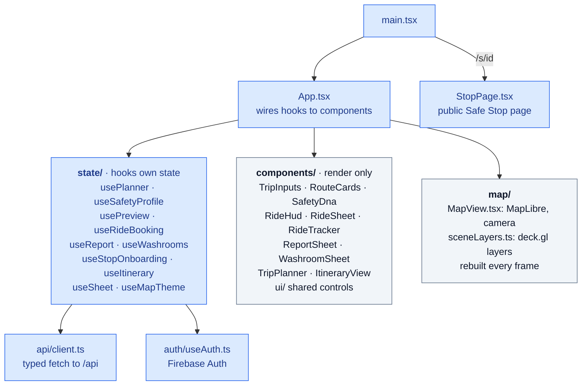

- **The scene** ([`web/src/map/sceneLayers.ts`](web/src/map/sceneLayers.ts)) is rebuilt every animation frame, and deck.gl diffs layers by id, so only animated layers get new data. Bottom to top: data dot-matrices, other routes, the selected route coloured per segment, pulsing dark stretches and dead zones, light "comets" along the route, stops, report pillars, washroom pins, the booked ride and checkpoints, and the rider and driver pucks.
- **Ride preview** ([`web/src/state/ridePreview.ts`](web/src/state/ridePreview.ts)) is a re-timeable clock: changing speed or camera, pausing and resuming fold progress into a start point and restart the clock, so the rider never jumps. Speed is a pace on screen, so 1× looks the same in every camera preset.
- **City time everywhere**: every time shown uses the city's `utcOffsetMinutes` ([`web/src/lib/format.ts`](web/src/lib/format.ts)), never the browser's zone.
- **Phones** (760 px and narrower) get one draggable bottom sheet with three detents; while a finger drags, its height goes straight to a CSS variable instead of React state, so the app doesn't re-render every frame.
- **Day and night basemaps** share an identical layer stack, so a switch is a paint-only change. On the night map the deck.gl canvas is screen-blended so colours glow; on the day map colours are deepened in OKLab to stay readable.

## API reference

All endpoints answer JSON; errors look like `{ "error": { "code", "message" } }`. Every client gets 100 requests a minute overall, and the limits below apply per route. *Session* means the `x-ny-session` header, needed only for live rides.

| Endpoint | Auth | Limit | Purpose |
| --- | --- | --- | --- |
| `GET /healthz` | | | Liveness, `{"status":"ok"}` |
| `GET /api/config` | | | Parameters, presets, defaults, cities with ride support, contact address |
| `GET /api/cities/:cityId/layers` | | | Night-light and cell-density grids for the map |
| `GET /api/places/suggest?q&city` | | 300/min | Type-ahead place search |
| `GET /api/places/reverse?lon&lat` | | 60/min | Name for a point on the map |
| `POST /api/plan` | | 20/min | Fetch, analyse and score up to three routes; returns a `searchId` |
| `POST /api/plan/:searchId/score` | | 120/min | Re-weight a stored search, no network calls |
| `POST /api/itinerary` | | 30/h | Day-trip plan |
| `POST /api/reports` | sign-in | 30/h | Add a rider report (and 5/h, 20/day per rider) |
| `GET /api/me` | sign-in | | Who am I |
| `GET` `PUT /api/me/preferences` | sign-in | | Read or save Safety DNA |
| `POST` `GET` `DELETE /api/rides/link` | | 5 links per 15 min | Link, check or unlink Namma Yatri |
| `POST /api/rides/quote` | session for live | 10/min | Price the usual and the safe route |
| `POST /api/rides` | session for live | 6/min | Book the chosen option |
| `GET /api/rides/:ref` | session for live | 60/min | Status, driver, progress, off-route flag |
| `POST /api/rides/:ref/cancel` | session for live | 10/min | Cancel |
| `POST /api/rides/:ref/detour` | | 20/min | Demo only: simulate a wrong turn |
| `GET /api/washrooms?lon&lat` | | | Washrooms near a point |
| `GET /api/stops/:id` | | | A listed Safe Stop |
| `GET /api/stops/mine` | sign-in | | The owner's stops |
| `POST /api/stops`, `PUT /api/stops/:id` | sign-in | 60/h | Create or edit a listing |
| `POST /api/stops/:id/verify` | sign-in | 60/h | Check the domain proof (20 attempts/h per account) |
| `POST /api/stops/domain-ideas` | sign-in | 20/h | Domain name ideas for a shop |
| `GET /api/domains/availability?domain` | sign-in | | GoDaddy availability for one domain |
| `POST /api/contact` | | 3/h | Contact form |

Route planning is public on purpose: a rider must never need an account to find a safer way home.

## Design decisions

1. **Score segments at their arrival minute, not routes at the departure minute.** Lighting, open shops and crowds change by the hour, and a 40-minute ride can cross dusk. *Trade-off:* every segment needs its own ETA, so the Valhalla client spreads each manoeuvre's time over its vertices.
2. **Measure once, weigh many times.** `plan` does all the IO and analysis; `rescore` is pure arithmetic on a cached analysis, which is what makes sliders live. *Trade-off:* searches live in memory for 30 minutes, and traffic is a snapshot from plan time.
3. **Pure engines behind ports.** Safety, rides, trips and washrooms are pure functions with time passed in, and vendors sit behind interfaces. Tests run on synthetic cities and fakes, and each integration is optional: no TomTom key means crowd scores use open places; no Anthropic key means the basic trip planner.
4. **A route can't hide its worst stretch.** The worst-10% term and multiplicative penalties make one isolated dark stretch count, and keep two bad routes distinguishable.
5. **Unknown is not unsafe.** Missing data lowers confidence, not the score, and estimated opening hours are flagged as estimates.
6. **Reports are evidence, not votes.** They decay, match the time of day and fade with distance, and three reports overturn a sensor. Ids are hashes, so no report can be traced to a rider.
7. **The AI picks, it never invents.** Claude chooses refs from our own list in a line format we validate line by line; times, routes and gap-filling are ours, with a basic planner behind it.
8. **Stops are the contract with the driver.** Ride apps price and route through stops, so safety checkpoints make the safe route the agreed route before pickup.
9. **Ownership proven by DNS, brand proven by RDAP.** A TXT record proves control of the domain; the registrar check makes it a GoDaddy domain.
10. **One process, one origin.** The API serves the built web app, so production needs no CORS, the CSP lives in one place, and a deploy is a single upload. *Trade-off:* in-memory state means one instance (see [Limits](#limits-and-whats-next)).
11. **The browser never touches the database.** It loads only Firebase Auth; all data goes through the API, where zod and the auth guards apply.
12. **City time, not server or browser time.** Opening hours, night rates, day bands and the dusk limit all use the city's wall clock, so the result doesn't depend on where the server or the rider's phone is set.

## Security and privacy

- **Secrets** live only in `.env` (gitignored) and GoDaddy's encrypted hosting secrets. The deploy bundle never includes `.env`, and secret values are never printed.
- **Logs** redact `Authorization`, cookies and the `x-ny-session` header. Stored searches (route geometry) are never logged.
- **Auth**: Firebase ID tokens are verified on the server. Account actions (reports, preferences, Safe Stop listings, domain checks) use `requireAuth`; route planning, washrooms and demo rides stay public.
- **Input**: every body, query and upstream response is parsed with zod; request bodies are strict. Client errors carry stable codes, and upstream details never leak (a GoDaddy 401 is our credential problem, so it surfaces as 502).
- **Abuse**: a global rate limit plus per-route limits, per-account limits in the services, and a honeypot field on the contact form.
- **Browser**: `helmet` sends a CSP listing every origin the page loads from (OpenFreeMap, Google Fonts, Firebase sign-in), and `same-origin-allow-popups` so Google sign-in can report back.
- **Privacy by design**: reports store no reporter identity, the Namma Yatri token never reaches the browser, and the AI model sees place names, never the rider.
- **GoDaddy**: `GODADDY_ENV` defaults to the OTE sandbox. GoDaddy keys have no scopes, so a production key can do anything on the account; revoke it when you are done.
- **Firestore rules**: `firestore.rules` denies every client read and write, since only the admin SDK should touch data. Release it with `firebase deploy --only firestore:rules`.

## Hosting and deployment

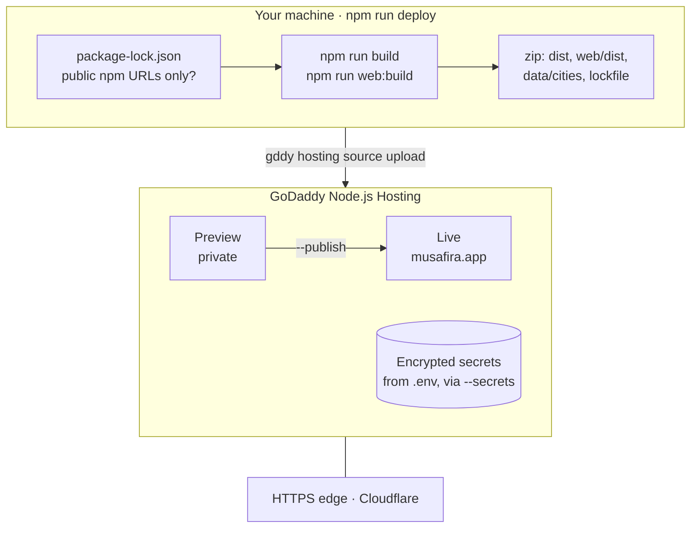

```bash
npm run deploy                 # build here, upload, wait for the private preview
npm run deploy -- --publish    # ...then publish the preview to the live site
npm run deploy -- --secrets    # copy .env server settings to preview and live, restart both
npm run golive:check -- musafira.app   # read-only launch check
```

- The host installs only runtime dependencies, so everything is built locally and the hosted `package.json` simply runs `node dist/server.js`.
- The host fails with no detail on any download URL that isn't the public npm registry, so the deploy stops before uploading if `package-lock.json` has one.
- `golive:check` reads from the `gddy` CLI and the live site: domain active, attached with its certificate, A record, HTTPS on apex and www, HTTP redirect, mailbox ready, MX, SPF, DKIM and DMARC, and the contact form wired. It changes nothing and sends no mail.
- The agent skill in [`.claude/skills/godaddy-go-live/`](.claude/skills/godaddy-go-live/SKILL.md) walks through domain, HTTPS, mailbox, contact mail and Firebase setup on GoDaddy hosting, ending in this check.

## Run it locally

```bash
npm ci && npm ci --prefix web
cp web/.env.example web/.env       # optional: Firebase web config for sign-in
npm run dev                        # API on http://localhost:3000
npm run web:dev                    # app on http://localhost:5173, proxies /api
```

Guests don't need an account: Safety DNA is kept in the browser, and signing in only syncs it. Apart from Firebase, every key below is optional, and the API logs a warning at start-up for each feature it turns off.

<details>
<summary><b>Configuration (<code>.env</code>)</b></summary>

| Variable | Turns on | Without it |
| --- | --- | --- |
| `PORT`, `LOG_LEVEL`, `CORS_ORIGINS` | Server basics | Port 3000, `info` logs, no cross-origin access |
| `VALHALLA_URL` | Routing | The public fair-use server |
| `TOMTOM_API_KEY` | Live traffic when leaving now | People-around uses open places only |
| `ORS_API_KEY` | Geocoding top-up, reverse lookup | City index only; reverse lookup returns 503 |
| `ANTHROPIC_API_KEY`, `ANTHROPIC_DAILY_BUDGET_USD` | AI day trips (budget defaults to $1/day) | Basic trip planner |
| `NAMMA_YATRI_LIVE`, `NAMMA_YATRI_API_URL` | Live rides in Bengaluru | Demo rides everywhere |
| `GODADDY_ENV`, `GODADDY_OTE_API_KEY/SECRET`, `GODADDY_PRODUCTION_API_KEY/SECRET` | Domain availability and ideas | Ideas use the registry answer; `/api/domains/*` returns 503 |
| `SMTP_HOST`, `SMTP_PORT`, `SMTP_USER`, `SMTP_PASSWORD` | Contact form | Form hidden; `/api/contact` returns 503 |
| `FIREBASE_PROJECT_ID`, `FIREBASE_SERVICE_ACCOUNT_JSON` | Sign-in, Firestore | Required (or the emulators below) |
| `FIREBASE_AUTH_EMULATOR_HOST`, `FIRESTORE_EMULATOR_HOST` | Local emulators | |
| `OPENCELLID_API_KEY`, `NASA_EARTHDATA_TOKEN` | `npm run ingest` only | |

The web app reads `VITE_FIREBASE_*` from `web/.env`. That config is public by design: it identifies the project, while security comes from server-side token checks.

</details>

<details>
<summary><b>Firebase setup (free Spark plan)</b></summary>

1. https://console.firebase.google.com: create a project and stay on **Spark**.
2. Build → Authentication: enable Email/Password (and Google).
3. Build → Firestore Database: create it in production mode, in a region near you.
4. Project settings → Service accounts → *Generate new private key*. Paste the JSON as one line into `FIREBASE_SERVICE_ACCOUNT_JSON` (or base64-encode it), then delete the downloaded file.
5. Set `FIREBASE_PROJECT_ID`.

</details>

<details>
<summary><b>GoDaddy API keys</b></summary>

1. Sign in at https://developer.godaddy.com and create an OTE key and a production key.
2. Put each key and secret in `.env` (`GODADDY_OTE_API_*`, `GODADDY_PRODUCTION_API_*`).
3. Set `GODADDY_ENV` to `ote` or `production`, then run `npm run smoke:godaddy`.

</details>

<details>
<summary><b>Refreshing city data</b></summary>

```bash
npm run ingest -- pune         # or bengaluru
```

Needs `OPENCELLID_API_KEY` and `NASA_EARTHDATA_TOKEN`. Raw downloads are cached in `data/raw/`, so a re-run only rebuilds the output.

</details>

<details>
<summary><b>Note on npm registries</b></summary>

`package-lock.json` points at `registry.npmjs.org`, and the deploy depends on it. If your machine uses a corporate mirror, npm still resolves through the mirror, but rewrite any mirror URLs in the lockfile before committing. `overrides.protobufjs` is pinned to a version that resolves on such mirrors; remove the pin when you can install the latest.

</details>

## Testing and CI

```bash
npm run typecheck && npm test     # API, scripts and tests
npm run web:typecheck             # web app
npm run smoke:godaddy             # read-only check of the GoDaddy key for GODADDY_ENV
npm run smoke:nammayatri -- <code>   # sign in with a fresh code and fetch fares; never books
```

- Tests use Vitest. Routes are exercised through Fastify's `app.inject` with injected fakes, so no test calls the network.
- The safety engine is tested on synthetic cities from [`test/fixtures.ts`](test/fixtures.ts) and asserts relative outcomes ("the lit route outranks the dark one"), not exact scores, so tuning a constant doesn't break the suite.
- GitHub Actions runs `npm ci`, the API typecheck, the tests and the web typecheck on every push and pull request (Node 22).

## Project layout

```text
src/
  server.ts          composition root: config, adapters, services, listen
  app.ts             Fastify app: security plugins, error mapping, route registration
  config/            zod-validated env; the only reader of process.env
  auth/              Firebase token verification, requireAuth guard
  routes/            one file per resource, thin: parse, delegate, shape
  planner/           application services and ports (routes, rides, reports, Safe Stops, trips)
  safety/            pure scoring engine: segmentation, features/, community, stops, scoring
  rides/             pure ride engine: checkpoints, route guard, demo meter and driver
  itinerary/         pure trip engine: candidates, prompt and parser, fill, schedule
  stops/             Safe Stop questionnaire and domain proof, washroom ranking
  city/              city schema, spatial index, place search, opening hours
  geo/               distances, polylines, measured paths
  integrations/      one folder per vendor: valhalla, tomtom, ors, godaddy, anthropic,
                     nammayatri, rdap, dns, smtp
  db/                Firestore stores: preferences, reports, Safe Stops
  lib/               errors, fetch with schema, TTL cache
scripts/             ingest/, deploy, go-live check, smoke checks
data/cities/         one committed JSON file per city
web/src/
  main.tsx, App.tsx  entry and wiring; StopPage.tsx for /s/<id>
  state/             hooks that own app state
  components/        presentational components, each with its CSS beside it; ui/ for shared controls
  map/               MapLibre style, MapView camera, deck.gl scene layers
  api/               DTO types and the fetch client
  lib/               formatting in city time, colours, track maths
  styles/            tokens, shared panels, motion, responsive layer
test/                Vitest suites and synthetic city fixtures
```

Files with non-obvious logic (a formula, a tuning constant, time zones, an external data format) open with a short doc comment explaining the what and the why. [`AGENTS.md`](AGENTS.md) lists them and the project's working rules.

## Limits and what's next

- **One instance.** Searches, rides, sessions, rate counters and the report and Safe Stop indexes live in process memory. That's right for a single process; scaling out needs a shared store (Redis or Firestore) for them. A restart forgets active searches and rides.
- **Public routing server.** `valhalla1.openstreetmap.de` is fair-use only; point `VALHALLA_URL` at a self-hosted Valhalla before real rider numbers.
- **Proxies, not ground truth.** Night lights are a yearly satellite composite (they won't see a broken streetlight), cell density is not signal strength, and most OSM shops have no opening hours. Rider reports exist to correct exactly these gaps.
- **Two cities.** Adding one means an ingest run plus a meter tariff for demo rides.
- **Live rides** cover Bengaluru only, for rides leaving now, and stay off until `NAMMA_YATRI_LIVE=true`.
- **No web tests yet**, and the TomTom, openrouteservice, SMTP and DNS clients have no tests of their own.

## Data sources and credits

© OpenStreetMap contributors (ODbL) · NASA Black Marble VNP46A4 (public domain) · OpenCelliD (CC BY-SA 4.0) · OpenFreeMap tiles · Valhalla · TomTom Traffic Flow · openrouteservice · Namma Yatri · Anthropic Claude · GoDaddy Domains, Node.js Hosting and Professional Email · Firebase.
